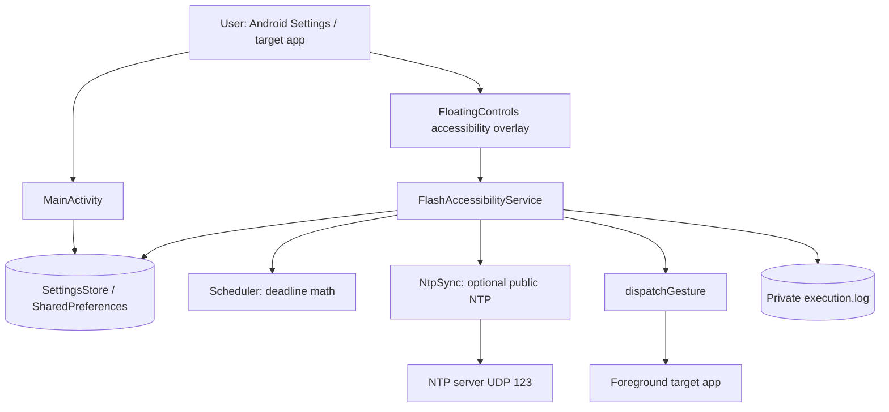
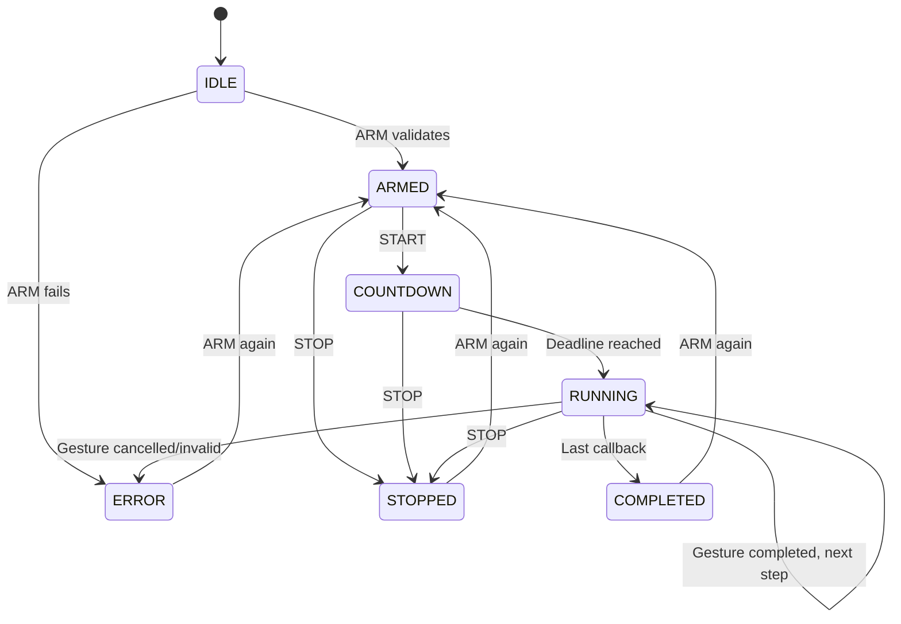

# System Design — FlashSale Helper

**Status:** Implemented prototype architecture, with future extension points distinguished below.  
**Android stack:** Kotlin, Android SDK 35, `AccessibilityService`, `TYPE_ACCESSIBILITY_OVERLAY`, private `SharedPreferences`, direct SNTP over UDP.

## 1. Context and boundary



No hooking, root services, input event injection binaries, intermediary cloud service or target-app credentials. The only planned network path is optional public SNTP. The target app manages its own traffic independently.

## 2. Components and responsibility

| Component | Responsibility | Important behavior |
|---|---|---|
| `MainActivity` | Settings and target list; permission guidance | Persists target time, early lead, dry-run flag, tap duration, target delays |
| `FloatingControls` | Movable overlay, clock, countdown, actions, crosshair picker | Accessibility overlay; picker consumes touches and requires SAVE; STOP remains visible in compact mode |
| `FlashAccessibilityService` | Service lifecycle, state, validation, serial gestures and logging | Uses a run token to invalidate stale callbacks following STOP; checks package and rotation on each step |
| `SettingsStore` | Local JSON array of normalized touch points in preferences | Clamps durations and delays; points belong to one target app |
| `Scheduler` | Pure time computation | Next time occurrence, explicit early lead, convert wall-clock plan to monotonic deadline |
| `NtpSync` | Optional SNTP samples | Uses transmit/receive timestamps, chooses low-RTT measurements, reports offset/RTT/jitter |
| `execution.log` | Debug history | App-private, size bounded; does not contain application screen content |
| GitHub Actions | Build + release | CI automatic, release manual; secrets used only for release signing |

## 3. State machine



### ARM validation

Read a snapshot of all settings; ensure at least one point, maximum 25, all points share same target package, that package was the latest foreground app seen by Accessibility, rotation unchanged, coordinates valid, panel not covering any saved point. Derive next occurrence of target local wall time; estimate NTP offset if available, calculate optional RTT lead and compute monotonic deadline. Freeze this snapshot; settings changed later do not affect an armed run.

### START / countdown

Only ARMED can START. The current implementation schedules `Handler.postDelayed` checks, approaching the deadline in shorter intervals, rather than consuming CPU in a spin loop. The timer is based on `SystemClock.elapsedRealtimeNanos()` and is not a realtime scheduler. The overlay refreshes every ~33 ms during countdown and ~80 ms otherwise; the display is not a 1 kHz clock.

### RUNNING and STOP

Each step computes physical coordinates from normalized `(x,y)` using current display dimensions. It ensures that the foreground package and rotation still match and the overlay does not obscure the point. In live mode it submits one `GestureDescription` via `dispatchGesture`. The next point is queued only after Android calls `onCompleted`, plus that point's delay. In dry-run mode the same sequence is simulated without input.

STOP increments the run token and removes pending countdown checks; every queued action and gesture callback checks that token before scheduling subsequent steps. **The current physical gesture may finish after STOP**, because `dispatchGesture` cannot be atomically revoked. STOP means *no further new gestures*.

## 4. Time model and clock domains

- `W`: device wall time (UNIX epoch milliseconds), from `System.currentTimeMillis()`; can jump.
- `M`: monotonic time from `SystemClock.elapsedRealtimeNanos()`; resistant to wall-clock adjustments.
- `O`: estimated NTP offset in milliseconds (NTP time minus device wall time).
- `T`: target time as UNIX epoch in the device timezone, after finding the next occurrence using `(W + O)`.
- `R`: measured NTP RTT in milliseconds (not touch latency).
- `L`: lead adjustment: `manualEarlyMs + R * factor`, where factor is NONE (0), HALF (0.5) or FULL (1.0). NONE by default.

At ARM, derive elapsed-time deadline:

```
D_monotonic_ns = M_now + (T - (W_now + O) - L) * 1_000_000
```

The calculation takes a wall and monotonic sample close together. The real dispatch is attempted after `M >= D` subject to Android handler jitter. No public NTP server measures the shopping app's internal clock, server queueing or product allocation.

**Timing precision caveats:** wall-clock timestamps are millisecond resolution but display frames are typically 8–17 ms apart; `Handler` scheduling and gesture injection add unpredictable overhead; some devices sleep or throttle tasks. We record first-step dispatch deviation, not a promise of arrival at a server. Clock offset can stale; periodic refresh or a bounded maximum age is a recommended improvement.

## 5. Touch coordinates / overlays

Saved point:

```json
{
  "x": 0.5,
  "y": 0.7,
  "delayAfterMs": 150,
  "rotation": 0,
  "targetPackage": "example.target.app"
}
```

A tap is saved after the user positions a crosshair and taps SAVE. Coordinates are ratios of physical display width/height, recorded in the active rotation. Reusing the point on other rotations is blocked. A full-screen `TYPE_ACCESSIBILITY_OVERLAY` captures picker events so selecting a target does not activate the underlying checkout screen. The ordinary panel occupies only its layout rectangle and can be dragged away from touch targets.

**Limitations:** physical screen dimensions and window insets differ across devices, foldables, navigation modes, split-screen, and keyboard states. The picker uses raw screen coordinates. For a production release, add per-device inset diagnostics, testing for edge touches, and optional node anchors.

## 6. Data security & privacy

- Android-private `SharedPreferences`: target coordinates, local time, delay and options.
- No exported provider, login/password storage, screenshot capture or raw accessibility node recording.
- `execution.log`: timestamp, x/y of configured gestures, deadline deviation and state/errors; private and bounded at ~128 KiB per rotation.
- Disable Android Auto Backup for app settings.
- Avoid storing merchant identity, UI text, personal addresses, payment card details or authorization tokens.
- Production APK must be signed with a stable, protected release key in GitHub Secrets; no credentials/keys in repository.

## 7. Operational failure cases

| Failure | Expected action |
|---|---|
| NTP unavailable / UDP 123 blocked | Fall back to device clock, show sync unavailable |
| Scheduled dispatch already passed | Reject ARM or fail START if past deadline |
| Foreground app changed | Abort before next gesture |
| Rotation differs from target selection | Reject ARM / abort next gesture |
| Target is covered by overlay | Reject ARM / abort next gesture |
| `dispatchGesture` returns false | ERROR; do not schedule next step |
| Gesture callback cancelled | ERROR unless run token invalidated by STOP |
| Service interrupted/destroyed | STOP, invalidate callbacks, tear down overlays |
| Main process killed | No persistence of an armed run; re-arm manually |
| Network latency high | Show diagnostics, do not claim guaranteed success |

## 8. Build / CI design

- `ci.yml`: `push` and `pull_request` to `main`, JDK 17, Android SDK 35, Gradle 8.13, unit tests, debug APK build; no publication.
- `manual-release.yml`: GitHub `workflow_dispatch` tag/variant/prerelease inputs; verify tag format; test, build, verify signature and hash; upload workflow artifact; create a GitHub Release using repo `GITHUB_TOKEN` with `contents: write`.
- `debug` APK: temporary debug key on CI, always pre-release; not suitable for persistent Android updates.
- `release` APK: only if a keystore and passwords are provided through encrypted repository secrets. Keep key stable across releases.
- Do not republish existing tag with a different binary.

## 9. Forward design (not yet implemented)

1. Add a user-initiated latency calibration screen that records trigger and `onCompleted` callbacks, reports median/p95 device timings (not network request arrival).
2. Add per-package named profiles with schema migration and explicit export consent.
3. Add accessible UI view anchors with fallback to normalized points, and guards for expected app state.
4. Add safe human confirmation for a potentially final financial submission, and provide explicit no-go lists for checkout confirmation buttons.
5. Add crash-resistant session logs, device-specific QA and deterministic instrumentation tests using a sample target activity rather than live merchants.
6. Consider foreground execution support for devices with aggressive OEM process management, without promising wake-from-sleep timing guarantees.

## 10. Technical references

- Android AccessibilityService: https://developer.android.com/reference/android/accessibilityservice/AccessibilityService
- Android GestureDescription: https://developer.android.com/reference/android/accessibilityservice/GestureDescription
- Android SystemClock: https://developer.android.com/reference/android/os/SystemClock
- Gradle/Android compatibility: https://developer.android.com/build/releases/agp-8-13-0-release-notes
- GitHub CLI release create: https://cli.github.com/manual/gh_release_create
